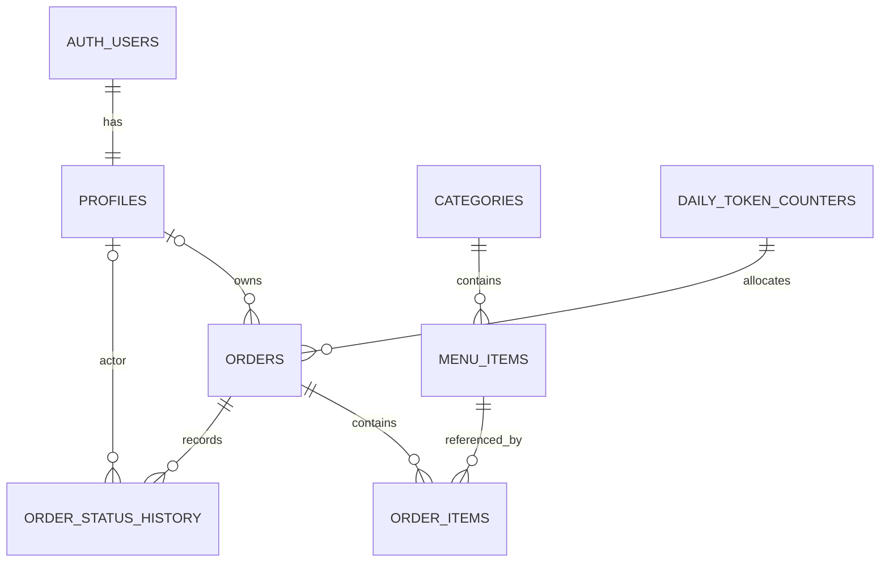

# Supabase database foundation

Phase 4 prepares the database for College Canteen. The files in this folder define the schema, permissions, sample menu, and verification steps. Apply the migration to your chosen Supabase project using the dashboard steps below.

The React homepage and cart continue to use the existing JavaScript demo data. This phase provides the database foundation for later authentication and ordering work.

## Files

| File | Purpose |
|---|---|
| `migrations/20261119000100_initial_schema.sql` | Creates the eight tables, indexes, constraints, triggers, grants, and RLS policies in one transaction. Apply once. |
| `seed.sql` | Optional, repeatable demo categories and eight dishes copied from `src/content/foodItems.js`. |
| `verify.sql` | Read-only inspection queries for the Supabase SQL Editor. |
| `tests/run-local.mjs` | Runs the migration and adversarial checks in a new temporary PostgreSQL cluster. |
| `tests/local_auth_stub.sql` | Minimal local-only stand-ins for Supabase Auth objects and roles. |
| `tests/schema_checks.sql` | Tests relationships, constraints, snapshots, daily tokens, audit history, and single-order preparation. |
| `tests/queue_priority_checks.sql` | Tests acceptance-time priority across both order sources, stable ties, preserved acceptance timestamps, and waiting-queue eligibility. |
| `tests/rls_checks.sql` | Tests access as anonymous, student, counter staff, kitchen, admin, and trusted backend roles. |
| `tests/concurrent_orders.sql` | Fixture transaction used by eight concurrent test clients. |

## Understand the database

A table is a collection of records. A primary key identifies one record. A foreign key links a record to another table and rejects references that do not exist. A UUID is a randomly generated identifier, suitable for records accessed through a web application.

RLS means Row Level Security. It decides which records a signed-in user may read or change. SQL grants also control which operations and columns a client can use. Both layers apply together. [Supabase RLS documentation](https://supabase.com/docs/guides/database/postgres/row-level-security)

Supabase's SQL role `authenticated` represents signed-in API requests. The application's Student, Staff, Kitchen, and Admin roles are stored separately in `profiles.role`. A private helper reads the role for `auth.uid()`, which is the verified request user's UUID.

## Tables and columns

| Table | Important columns and meaning |
|---|---|
| `profiles` | `id` matches `auth.users.id`. `full_name` is the display name, `email` mirrors Supabase Auth, and `role` is one of student/staff/kitchen/admin. Timestamps record creation and updates. |
| `categories` | UUID `id`, nonblank `name`, `description`, `is_active`, and timestamps. An inactive category is archived. Names are unique after trimming and ignoring case. |
| `menu_items` | UUID `id`, `category_id`, name, description, `price`, `image_url`, availability, and timestamps. Item names are unique within a category after trimming and ignoring case. |
| `orders` | UUID `id`, optional customer account `user_id`, `order_type`, required `customer_name`, `token_number`, `business_date`, full `token`, stable `queue_sequence`, status, optional `status_reason`, stored total, acceptance time, and timestamps. |
| `order_items` | UUID `id`, parent order and menu item IDs, saved item name and unit price, positive whole-number quantity, generated subtotal, and creation time. Each menu item occupies one line per order. |
| `order_status_history` | UUID `id`, order ID, previous/new status, actor UUID, wall-clock change time, and optional reason. An initial entry has a null previous status. |
| `daily_token_counters` | One record per business date, with the last allocated numeric token and update time. Clients have no direct access. |
| `canteen_settings` | One record with `id = 1`, `is_open`, optional opening/closing times, and update time. The initial setting is Closed, with hours left unset. |

The profile's display name can initially be blank if an account was created without name metadata. Email can be null for existing non-email Auth accounts. Online checkout must later require a completed name and email before creating an order. Orders already require a nonblank customer name and an account owner for source `online`.

New Auth users get Student access regardless of any `role` value they submit in user metadata. A trigger creates the profile and mirrors later Auth email changes. Existing Auth users are backfilled as Students. Passwords remain managed by Supabase Auth. [Supabase user-data documentation](https://supabase.com/docs/guides/auth/managing-user-data)

`price` and `unit_price_snapshot` use `numeric(12,2)` in rupees. `total_amount` and generated `subtotal` use `numeric(14,2)`. These types preserve decimal money amounts. Negative amounts and NaN are rejected. The Phase 3 value `4500` paise becomes SQL `45.00` rupees.

`subtotal` is calculated by PostgreSQL as `unit_price_snapshot * quantity`. A later trusted ordering operation must calculate and validate `total_amount` from its item snapshots in the same transaction. This foundation does not automatically sum order lines into the order header.

The full `token`, `queue_sequence`, `status_reason`, and history `reason` columns supplement the requested fields to preserve date-prefixed identifiers, stable ordering, and rejection/cancellation explanations.

## Relationships and history



Walk-in orders can have a null `user_id`. Online orders require one. An order references its account profile, which references Supabase Auth.

Category, food-item, order, and audit references use deletion restrictions to protect history. Archive a category with `is_active = false` and stop serving an item with `is_available = false`. Archiving a category also hides its items from public catalogue reads. Existing orders and saved item names/prices remain intact.

The Auth-to-profile link uses cascade deletion, but a profile referenced by orders or audit history is protected by the downstream restrictions. Account deletion with historical activity therefore needs a deliberate future retention/anonymization process.

## Tokens, statuses, and queue support

Both sources use `orders` and the same private token allocator. An order insert increments the relevant daily counter with `INSERT ... ON CONFLICT ... DO UPDATE`. PostgreSQL locks that counter row, so simultaneous inserts receive different numbers. The allocation rolls back if the transaction fails. [PostgreSQL INSERT documentation](https://www.postgresql.org/docs/18/sql-insert.html)

For example, business date `2026-11-19` and number `41` produce `20261119-041`. After `999`, the suffix expands to `1000`. The unique date/number pair and unique full token preserve identity across dates. Collection, cancellation, and rejection leave the records in history, retaining their tokens.

New orders start as Placed. The database assigns the creation timestamp after acquiring the daily counter lock. `created_at` records order creation and supports history lookups. Preparation priority uses the trusted acceptance timestamp, with the unique `queue_sequence` identity resolving equal acceptance times. The business date is required input from a future trusted ordering operation. The canteen timezone and business-day cutoff still need confirmation.

Forward status transitions are guarded as follows.

```text
placed -> accepted -> preparing -> ready -> collected
placed -> rejected
placed -> cancelled
accepted -> cancelled
```

Rejected requires a reason. Preparing cannot be cancelled. Collected, Cancelled, and Rejected are terminal. The trigger sets `accepted_at` when acceptance occurs and preserves it afterward. Each status change records an audit entry. `changed_by` uses `auth.uid()`. A null actor means a database-owner/system action without an authenticated-user context. Future server operations must carry a verified actor context and require reasons for staff cancellations.

The partial unique index `orders_single_preparing` permits one Preparing order across the canteen. Ready orders leave this constraint and can wait for collection while another order is prepared.

### Confirmed preparation priority

On 19 November 2026, the user confirmed `accepted_at ASC, queue_sequence ASC` as preparation priority. The oldest Accepted order is prepared first. Online and walk-in orders use the same ordering rule. Placed orders await acceptance and have no preparation queue position. Preparing and Ready orders are outside the waiting preparation candidates.

The partial index `orders_accepted_time_idx` covers `(accepted_at, queue_sequence)` for `status = 'accepted'`. The read-only candidate query in `verify.sql` uses this ordering. The separate `orders_user_created_idx` supports user order history. The eventual authorized preparation operation must atomically choose the first eligible record, check role permissions, and acquire the preparation slot.

```sql
select id, token, order_type, accepted_at, queue_sequence
from public.orders
where status = 'accepted'
order by accepted_at asc, queue_sequence asc;
```

For example, if an online order is created first but a later walk-in order is accepted first, the walk-in order leads the preparation candidates. Equal acceptance timestamps use `queue_sequence ASC` for a deterministic result. The trigger assigns `accepted_at` on acceptance and preserves it during subsequent updates.

The Phase 4 status list omitted Rejected. It is retained here because the previously approved flow explicitly requires rejection and historical Rejected orders. Confirm its retention before implementing operational APIs.

This schema has one primary role per profile as requested in Phase 4. If independently assigned Staff and Kitchen capabilities must coexist on the same non-admin account, a later role-membership extension will be needed. Earlier documentation allows that possibility.

## RLS and permissions

All eight tables enable RLS. Default grants for these tables are replaced explicitly. The private helper functions have a fixed empty search path, qualified table names, and restricted execution. Keep `canteen_private` outside the Data API's exposed schemas. [Supabase function security](https://supabase.com/docs/guides/database/functions)

| Table | Client access and policy purpose |
|---|---|
| `profiles` | A user reads their own record and can update only `full_name`. Admin can read profiles. Clients cannot insert profiles, update email/role, or delete profiles. |
| `categories` | Public users read active categories. Admin reads archived categories and can insert/update categories. Archiving uses an update. |
| `menu_items` | Public users read items in active categories, including out-of-stock items. Admin reads all items and can insert/update prices, descriptions, and availability. |
| `orders` | Students read their own orders. Counter staff/admin read operational orders. Kitchen reads Accepted, Preparing, and Ready orders. All direct client writes are withheld in this foundation phase. |
| `order_items` | A client reads a line only when its parent order is visible through RLS. Direct client writes are withheld. |
| `order_status_history` | Owners and counter staff/admin read the relevant history. Clients cannot create, alter, or delete audit rows. Triggers record history. |
| `daily_token_counters` | No anonymous or authenticated access. Even the backend allocates tokens through the order insert trigger. |
| `canteen_settings` | Public users read the one settings record. Only Admin can update it. |

There are no public/anonymous write policies and no client deletion grants. The browser never receives a service-role credential. The service role bypasses RLS, so any future backend using it must independently verify the caller and permissions.

Authentication UI and protected ordering/status RPCs belong to later phases. Counter and Kitchen clients therefore have read access without direct order-status writes at present. The future operations must enforce their exact transition permissions. Student cancellation also needs an owner-checked server operation.

Before enabling ordering, the server operation must validate canteen Open/Closed policy, required name/email, current availability and prices, positive quantities, item snapshots, the order total, ownership/source, and a retry/idempotency key in one transaction. The browser currently has no grant that could bypass those future checks. Manual trusted SQL fixture inserts are possible while the canteen is Closed.

Sales reports must sum Collected orders only. For example, a later reporting query can use `sum(total_amount) where status = 'collected'`. Date-filtered reporting still needs a creation-date versus collection-date decision.

## Apply the schema in Supabase

1. Sign in to the Supabase dashboard and select your intended existing project. If you have no Supabase project, use the dashboard's New project flow, choose a database password privately, and wait for provisioning. This setup uses your existing React/Git repository.
2. Confirm the project name in the dashboard selector. Inspect the Table Editor for existing `profiles`, `categories`, `menu_items`, `orders`, `order_items`, `order_status_history`, `daily_token_counters`, or `canteen_settings` tables. If any already exist, inspect the schema and migration history before applying this initial migration.
3. Open SQL Editor, create a new query, and paste the entire contents of `migrations/20261119000100_initial_schema.sql`. Run it as the project database owner.
4. Confirm the query succeeds. The file runs in one transaction. An existing conflicting object or a SQL error aborts the migration. Existing objects are not dropped or replaced.
5. Open Table Editor, select the public schema, and verify all eight tables appear. The settings table should have one Closed record with unset operating hours.
6. Optionally run `seed.sql` in a separate SQL Editor query. It adds five sample categories and eight sample foods in a fresh database. The seed can be repeated and preserves existing matching names, edited prices, availability, and archived categories. It creates no accounts or orders.
7. Run `verify.sql`. Inspect columns, foreign keys, checks, indexes, and policies. Verify all eight RLS flags are true, the anonymous/public write-policy query returns zero rows, and the three permission booleans are false.
8. Inspect the dashboard's database policies and Security Advisor. Retain the project's standard exposed schemas and keep the private helper schema unexposed.

The initial migration is applied once. To change an applied schema, add a new migration. The timestamped filename is compatible with later Supabase CLI use, but running SQL manually does not populate CLI migration history. Reconcile that history before adopting CLI pushes against the same project.

### First admin and staff role assignment

Use an existing Supabase Auth account or the dashboard's trusted invite/provisioning flow. Find its UUID under Authentication → Users. The profile trigger always assigns Student initially.

As the project owner in SQL Editor, substitute the verified Auth UUID in the following statement and confirm exactly one returned row.

```sql
update public.profiles
set role = 'admin'
where id = 'REPLACE-WITH-THE-VERIFIED-AUTH-UUID'::uuid
returning id, role;
```

The same trusted process can assign `staff` or `kitchen`. Browser clients have no permission to write the role column, including a signed-in app Admin. A later admin interface must use a reviewed server-side operation that verifies Admin authority before making this update. Role assignment is never based on self-registration fields or user-editable metadata.

### Verify access separately from schema inspection

SQL Editor normally runs with database-owner privileges, which bypass RLS. Seeing all rows there does not prove that student access is safe. The local checks below switch database roles and user identities to test permissions. Real Supabase verification later also needs actual authenticated requests with two different user accounts.

For a read-only SQL simulation in your project, substitute an existing Auth UUID and run the entire transaction.

```sql
begin;
set local role authenticated;
select set_config('request.jwt.claim.sub', 'REPLACE-WITH-A-REAL-AUTH-UUID', true);
select id, token, status from public.orders;
rollback;
```

An empty result is expected if that Student has no orders. The local test Auth fixtures are never applied to a hosted Supabase database.

## Run local verification

The test runner uses the existing Node installation and PostgreSQL binaries. On this Windows machine, the default binary directory is `C:/Program Files/PostgreSQL/18/bin`.

```powershell
node supabase/tests/run-local.mjs
```

If PostgreSQL is installed elsewhere, set `POSTGRES_BIN` to its binary directory. `CANTEEN_TEST_PORT` can override the default port `6543` if it is busy. The runner creates its own temporary cluster and binds it to `127.0.0.1`. Test-only trust authentication is used for the fixture roles. No existing database server is stopped or reset.

The runner applies Auth stubs, the migration, and the seed twice, then tests schema constraints, historical snapshots, status guards, acceptance-time preparation priority, and access as multiple roles. The queue regression accepts two orders in reverse creation order, checks the shared acceptance-time ordering, exercises equal-time ties, and checks that Placed, Preparing, and Ready orders are outside waiting preparation candidates. It modifies the demo catalogue in its isolated cluster and confirms re-seeding preserves those edits. Finally, eight pgbench clients create 20 online and 20 walk-in fixture orders, checking for 40 distinct tokens and complete item rows.

The local server is stopped in a `finally` block. Temporary test data and logs are retained at the printed location for inspection. The fixture SQL uses fake users and dates in the future. Only `migrations/...sql`, optional `seed.sql`, and read-only `verify.sql` belong in the live dashboard workflow.

Local Auth stubs test PostgreSQL behavior and policies. They do not emulate Supabase's hosted Auth service, signed JWT validation, PostgREST, or dashboard configuration. Live deployment and live API verification remain manual steps until access is available.

### Recorded local result

On 19 November 2026, the final run passed on the installed PostgreSQL 18.4 binaries. The migration executed successfully, all eight tables had RLS enabled, and the schema, acceptance-time queue regression, and role-based security checks passed. Repeated seeding preserved edited data. Eight concurrent clients created 20 online and 20 walk-in fixture orders with 40 distinct tokens and complete item rows. The verification queries executed successfully, and the temporary server stopped afterward.
